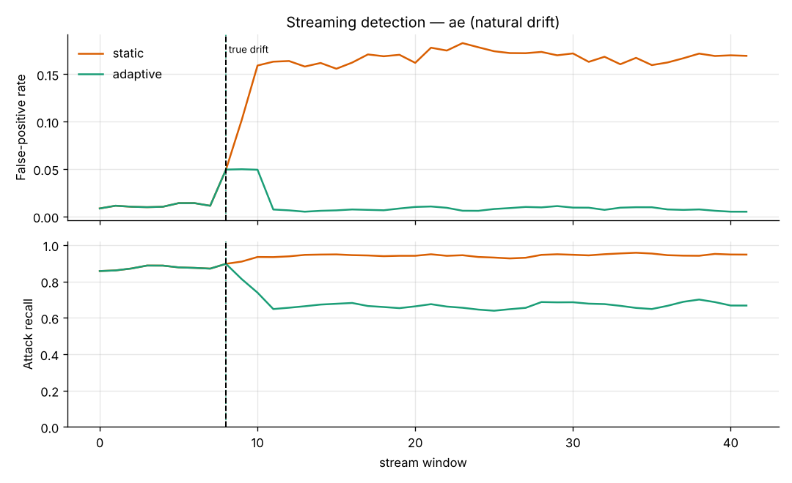
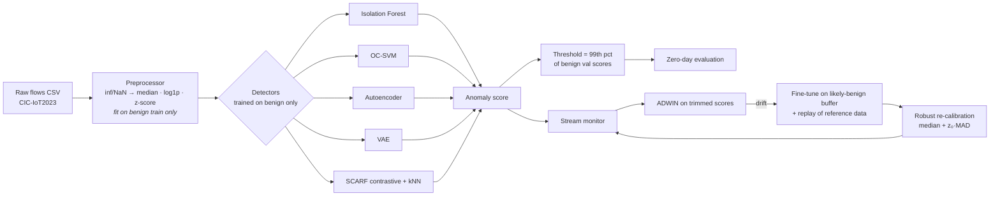
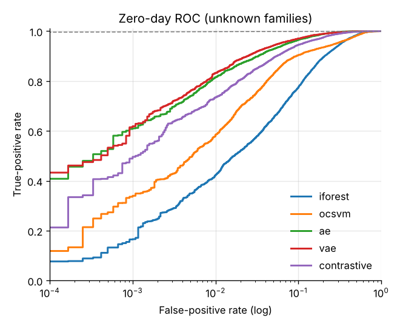
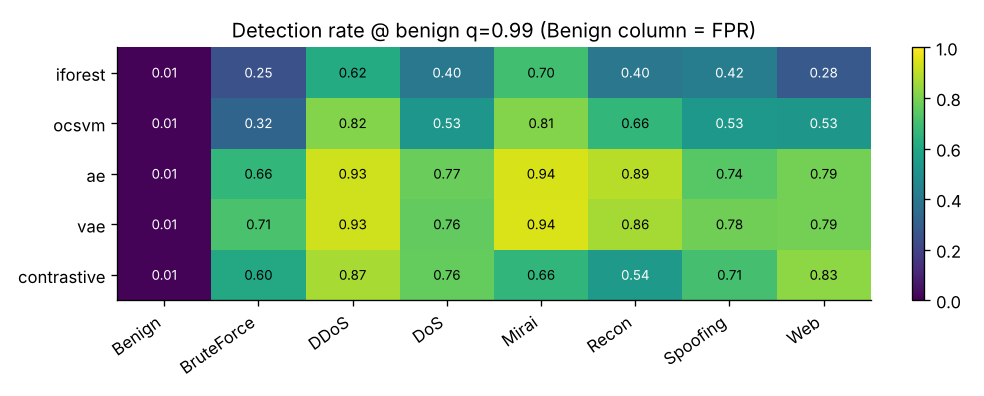

# 🛡️ Self-Supervised, Drift-Aware Zero-Day Intrusion Detection for IoT

[](../../actions)


> Detect **attacks the model has never seen** in IoT network traffic, by learning only what *normal* looks like,
> and **stay accurate when normal changes** (concept drift), without needing labels.

Signature-based and supervised IDSs miss novel attacks because they only learn the classes in their training set.
This project trains anomaly detectors **on benign traffic only**, evaluates them under a strict **zero-day protocol**
(entire attack families held out), and wraps them in a **label-free drift-adaptation loop** for streaming deployment.

<p align="center"></p>

*After benign traffic drifts (dashed line), the static detector's false-positive rate jumps from about 1–2% to 17%. The adaptive
detector spots the drift with ADWIN, fine-tunes itself and returns to under 1% FPR.*

---

## ✨ Features

| | |
|---|---|
| **5 detectors behind one interface** | Isolation Forest, scalable One-Class SVM (Nyström + SGD), Autoencoder, VAE, **SCARF contrastive** encoder + kNN |
| **Zero-day evaluation** | Attack families (Mirai, Web, BruteForce, Spoofing) never touch training; "known" families reported separately |
| **No label leakage** | Scaler, imputer, feature selection and thresholds are all fit on benign data only |
| **Label-free drift adaptation** | ADWIN / Page-Hinkley on trimmed (likely-benign) scores → fine-tune with replay buffer → robust MAD threshold re-calibration |
| **Honest metrics** | ROC-AUC, PR-AUC, TPR@1% FPR, FPR@95% TPR, per-family detection & AUC, latency per flow |
| **Reproducible** | YAML configs, fixed seeds, every run saved to `runs/<name>/` (models, metrics, figures, config) |
| **Dashboard** | Streamlit app: benchmark, interactive threshold explorer, drift view, score your own CSV |
| **Engineering** | `pip install -e .`, CLI, 27 pytest tests, GitHub Actions CI, Docker |

## 🏗️ Architecture



## 📊 Results (synthetic demo data)

> ⚠️ These numbers come from the bundled **synthetic** generator (`iotids synth`) and only show that the pipeline
> works. Replace them with your CIC-IoT2023 results.

**Zero-day test** (benign + unseen Mirai / Web / BruteForce / Spoofing), threshold = benign q0.99:

| Model | ROC-AUC | PR-AUC | TPR @ 1% FPR | Recall | FPR | Fit (s) | µs / flow |
|---|---|---|---|---|---|---|---|
| Isolation Forest | 0.930 | 0.931 | 0.423 | 0.415 | 0.97% | 0.6 | 17.1 |
| One-Class SVM | 0.956 | 0.961 | 0.585 | 0.576 | 0.97% | 0.3 | 3.3 |
| Autoencoder | 0.987 | 0.988 | 0.815 | 0.798 | 0.86% | 27 | 3.3 |
| **VAE** | **0.989** | **0.989** | **0.833** | **0.816** | 0.91% | 27 | 3.3 |
| SCARF contrastive | 0.979 | 0.980 | 0.734 | 0.728 | 0.96% | 44 | 67 |

**Streaming with drift** (autoencoder):

| Mode | Period | FPR | Recall |
|---|---|---|---|
| Static | pre-drift | 2.5% | 0.88 |
| Static | post-drift | **16.8%** | 0.94 |
| Adaptive | post-drift | **0.8%** | 0.67 |

The static model's higher post-drift recall is not a real gain. It flags almost everything, so 1 in 6 benign flows
raises an alert. That alert fatigue is the problem adaptation fixes. Adaptation does trade some recall for it, which is
discussed under *Limitations*.

<p align="center">
 
</p>

## 🚀 Quickstart

```bash
git clone https://github.com/Kugashanth/iot-zeroday-ids.git && cd iot-zeroday-ids
python -m venv .venv && source .venv/bin/activate        # Windows: .venv\Scripts\activate
pip install -e ".[app,dev]"

make demo          # synthetic data -> train 5 models -> drift experiment  (~2-3 min on CPU)
make app           # dashboard at http://localhost:8501
make test          # 27 tests
```

Without `make`:

```bash
iotids synth --out data/synthetic
iotids train  --config configs/synthetic.yaml
iotids stream --config configs/synthetic.yaml --model ae
streamlit run app/streamlit_app.py
```

### Run on the real CIC-IoT2023 dataset

1. Download the CSV release (see [`data/README.md`](data/README.md)) into `data/CICIoT2023/`.
2. `iotids all --config configs/default.yaml`

Start with `max_files: 20, sample_frac: 0.25` (in the config), then scale up.

### Score new traffic

```bash
iotids predict --run runs/<run-dir> --model vae --input new_flows.csv --output scored.csv
```

### Docker

```bash
docker compose up --build      # runs the demo, then serves the dashboard on :8501
```

## 🔬 Method

**1. Preprocessing (benign-only fit).** Non-numeric and identifier columns are dropped. `±inf` becomes NaN, then the benign median.
Constant columns are removed. Heavy-tailed non-negative features (skew > 1) get `log1p`. Everything is z-scored and clipped to ±10.

**2. Zero-day split.** Benign rows are split 60/20/20 into train / val / test. Attack families listed in
`split.unknown_families` appear **only** in the test set. The remaining families are evaluated separately as "known".
No model ever sees an attack label.

**3. Detectors** (all output *higher = more anomalous*):
- **Isolation Forest**: path length in random trees.
- **One-Class SVM**: RBF kernel approximated with Nyström features plus a linear SGD OC-SVM, so it scales to millions of flows.
- **Autoencoder**: MLP 128-64-16-64-128 with BatchNorm and dropout. Score = per-flow reconstruction MSE.
- **VAE**: the same body with a Gaussian latent and β-weighted KL. Score = reconstruction MSE at the posterior mean.
- **SCARF contrastive** ([Bahri et al., ICLR 2022](https://arxiv.org/abs/2106.15147)). A random 30% of features are
  replaced with values drawn from their empirical marginal, and the encoder is trained with NT-Xent so both corrupted views
  map to the same embedding. Score = mean cosine-space distance to the *k* = 5 nearest benign embeddings.

Deep models use AdamW, cosine LR decay, gradient clipping and early stopping on the **benign** validation loss.

**4. Threshold.** τ = the 99th percentile of benign validation scores. This targets about 1% FPR without using attack labels.

**5. Drift adaptation** (labels are used for metrics only):
1. Score each window of *w* flows. Keep the lowest 60% of scores as *likely benign*. This stays robust while attacks
   are a minority of the window.
2. Feed those scores to **ADWIN** (or Page-Hinkley) and push the rows into a FIFO buffer.
3. On drift (with warm-up and cooldown): fine-tune on `buffer ∪ replay(reference benign)` at a reduced LR. The replay
   prevents catastrophic forgetting.
4. **Re-calibrate**: τ = median + z₀·σ_MAD on recent windows, where z₀ is the standardized position of the original
   threshold. Median and MAD tolerate up to 50% contamination.

## 📁 Project structure

```
iot-zeroday-ids/
├── configs/            default.yaml (CIC-IoT2023) · synthetic.yaml (demo)
├── src/iotids/
│   ├── data.py         loading, 34→8 family mapping, Preprocessor, zero-day splits
│   ├── synthetic.py    CIC-IoT2023-like generator with drift (for demo/CI)
│   ├── models/         base interface · classical.py · deep.py (AE, VAE, SCARF)
│   ├── metrics.py      thresholds, ROC/PR, TPR@FPR, per-family metrics, robust stats
│   ├── drift.py        ADWIN/Page-Hinkley stream runner, adaptation, static-vs-adaptive comparison
│   ├── pipeline.py     run_batch (benchmark) · run_stream (drift experiment)
│   ├── plots.py        report figures
│   └── cli.py          `iotids synth | train | stream | all | predict`
├── app/                Streamlit dashboard
├── notebooks/          01_quickstart.ipynb (executed, with outputs)
├── tests/              27 pytest tests (mapping, leakage, every model, drift, end-to-end)
├── runs/               experiment outputs (git-ignored)
├── Dockerfile · docker-compose.yml · Makefile · .github/workflows/ci.yml
```

## ⚠️ Limitations & ethics

- **Synthetic numbers are not real results.** Rerun on CIC-IoT2023, TON_IoT or N-BaIoT before you claim performance.
- **CIC-IoT2023 has no timestamps** in its CSV release, so drift on it is *simulated* (a configurable feature shift).
  Datasets with time order (or the synthetic data) show natural drift.
- **Adaptation can be poisoned.** An attacker who slowly ramps up traffic can be absorbed into "benign". Trimming,
  replay, cooldown and the fixed z₀ limit this but don't eliminate it. Production use needs human review of adaptations.
- **Recall vs FPR trade-off after adaptation.** The adapted model is tuned to the new normal, so subtle attacks close to
  it are harder to catch. Tune `threshold.quantile`, `trim_quantile` and `replay_ratio` for your setting.
- Flow-level features only. There's no payload inspection and no encrypted-traffic analysis.
- For defensive research and education. Use only on networks you own or are authorized to monitor.

## 🗺️ Roadmap

- [ ] Real CIC-IoT2023 / TON_IoT / N-BaIoT benchmarks, leave-one-family-out
- [ ] SHAP / per-feature reconstruction error to explain alerts
- [ ] Federated training across devices (Flower)
- [ ] ONNX export and Raspberry Pi edge benchmark
- [ ] Adversarial robustness evaluation (ART)

## 📚 References

- Neto et al., *CICIoT2023: A real-time dataset and benchmark for large-scale attacks in IoT environment*, Sensors 2023.
- Bahri et al., *SCARF: Self-Supervised Contrastive Learning using Random Feature Corruption*, ICLR 2022.
- Bifet & Gavaldà, *Learning from Time-Changing Data with Adaptive Windowing (ADWIN)*, SDM 2007.
- Mirsky et al., *Kitsune: An Ensemble of Autoencoders for Online Network Intrusion Detection*, NDSS 2018.
- Liu et al., *Isolation Forest*, ICDM 2008.

## 👤 Author

**T. Kugashanth** — BSc (Hons) Data Science, Sabaragamuwa University of Sri Lanka.
Builds on my systematic literature review on self-supervised, drift-aware anomaly detection for unknown IoT attacks.

MIT License.
